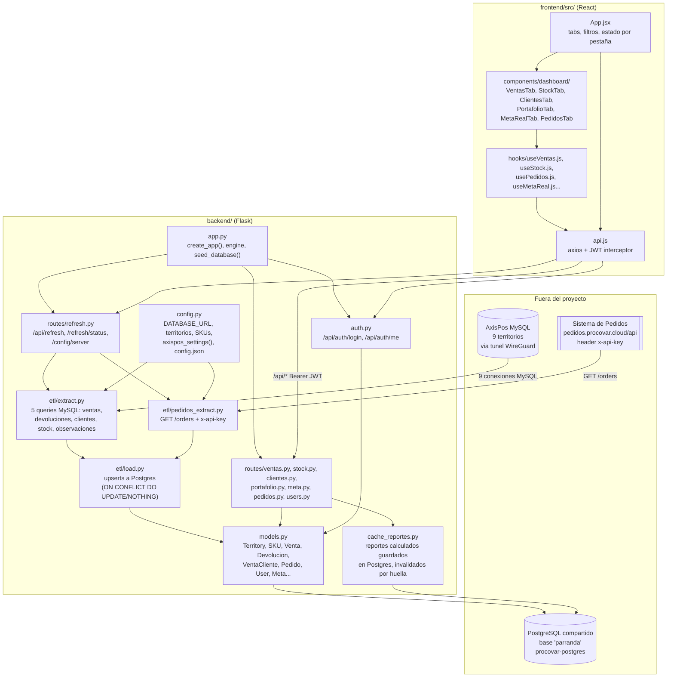

# Mapa interno — parranda-dashboard

## 1. Qué es

Tablero de inteligencia de ventas para las 5 SKU de Parranda/Malta, con login
propio (JWT, roles admin/viewer), metas mensuales y análisis de clientes. Junta
en un solo sitio datos que hoy viven repartidos: las 9 bases MySQL de AxisPos
(una por territorio, cada tienda con su propio servidor), el Sistema de Pedidos
(otra aplicación de Procovar), y las metas que antes solo existían en un Excel
(`Meta vs Real HL.xlsx`). Backend Flask + SQLAlchemy, frontend React + Vite.

## 2. Diagrama

## 3. Piezas

| Pieza | Dónde vive | De qué se ocupa |
|---|---|---|
| `app.py` | `backend/` | Arranca Flask, crea el engine de Postgres (con reintento ante DNS que parpadea), siembra territorios/SKUs/admin, registra los blueprints bajo `/api` |
| `config.py` | `backend/` | Único sitio con credenciales y ajustes de conexión: `DATABASE_URL`, host/user/pass de AxisPos (con overrides en `config.json`), URL y clave de Pedidos, mapa de territorios y catálogo de 5 SKUs |
| `models.py` | `backend/` | Modelos SQLAlchemy: `Territory`, `SKU`, `Venta`, `Devolucion`, `VentaCliente`, `RefreshLog`, `User`, `Meta`, `MetaMonthConfig`, `Pedido`, `PedidoItem`, `FacturaObservacion` |
| `auth.py` | `backend/` | Login JWT, `/api/auth/me`, decorador `admin_required` |
| `etl/extract.py` | `backend/etl/` | 5 consultas a cada MySQL de AxisPos (ventas, devoluciones, clientes, stock, observaciones de factura), filtrando por nombre de producto y reglas de negocio (OperType, Sign, fecha_min de Moa/Palma) |
| `etl/pedidos_extract.py` | `backend/etl/` | Llama `GET /orders` del Sistema de Pedidos con header `x-api-key`, mapea sucursales y SKUs propios de ese sistema |
| `etl/load.py` | `backend/etl/` | Vuelca lo extraído a Postgres vía upsert; nunca borra |
| `cache_reportes.py` | `backend/` | Guarda reportes ya calculados en Postgres para no repetir el cálculo en cada pestaña/usuario; se invalida por huella de los datos, no por contador |
| `routes/*.py` | `backend/routes/` | Un blueprint por área (ver endpoints abajo), todos montados en `/api` desde `app.py` |
| `constants.js` | `frontend/src/` | Territorios, SKUs, `API_BASE = "/api"`, conversión de unidades, helpers de fecha — espejo de `config.py` |
| `api.js` | `frontend/src/` | Instancia axios con interceptor JWT (token en `localStorage`); un 401 limpia el token y manda a login |
| `App.jsx` | `frontend/src/` | Puerta de login, pestañas visibles según `allowed_tabs`/`allowed_territories` del usuario, estado de filtros compartido |
| `hooks/useApiQuery.js` + `use*.js` | `frontend/src/hooks/` | Base común (GET con debounce, deps serializadas) y un hook por pestaña sobre ella |
| `components/dashboard/*Tab.jsx` | `frontend/src/components/dashboard/` | Una vista por pestaña |
| `components/shared/SkuPills.jsx` | `frontend/src/components/shared/` | Selector de SKU con comportamiento propio (clic aísla, vacío/completo vuelve a "todos") |
| `docker-compose.yml` | raíz | Definición de despliegue: backend + frontend, sin Postgres propio (usa el compartido del VPS) |

### Endpoints (todos bajo `/api`, todos requieren JWT salvo login)

`auth.py` login/me · `ventas.py` territorios/skus/ventas · `stock.py` stock (en
vivo contra MySQL) · `clientes.py` clientes-compras · `portafolio.py` portafolio
· `pedidos.py` **un solo** `GET /pedidos` que arma todos los desgloses de esa
pestaña (por_dia, por_territorio, fugas, domicilio, vendedor, sku, leadtime) ·
`meta.py` metas/metas-copy/meta-real · `users.py` CRUD de usuarios (admin) ·
`refresh.py` refresh/retry/status, SSE en `/refresh/stream`, config del server
AxisPos (admin).

## 4. Fronteras — con qué habla fuera

- **AxisPos MySQL** (9 bases, una por territorio, la de referencia en
  `192.168.1.3:3306`): se llega por túnel WireGuard desde el VPS. `etl/extract.py`
  hace las consultas; sin túnel esta parte no funciona pero el resto del panel sí.
- **Sistema de Pedidos** (`pedidos.procovar.cloud/api`, otra aplicación de
  Procovar): REST, header `x-api-key`, solo se usa `GET /orders`. La clave y la
  URL están en `config.json` o en las env vars `PEDIDOS_API_URL`/`PEDIDOS_API_KEY`.
- **PostgreSQL**: NO tiene Postgres propio en el VPS — usa la instancia
  compartida `procovar-postgres` (Dokploy), base `parranda`, vía `DATABASE_URL`.
  Es también donde vive la caché de reportes (`cache_reportes.py`).
- **Frontend ↔ Backend**: mismo dominio, `API_BASE = "/api"`; en producción
  Traefik enruta `ccsa.procovar.cloud` a los contenedores `backend`/`frontend`
  sobre la red `dokploy-network`.
- No comparte base de datos ni código con otros proyectos de Procovar (pedidos,
  delivery, analitics) — solo consume la API pública de Pedidos como cliente.

## 5. Por dónde entrar

1. **`CLAUDE.md`** (raíz) — antes que el código: reglas de negocio (qué cuenta
   como venta, por qué Sign=-1, el corte de Moa/Palma Soriano) que no se ven
   leyendo las queries a secas.
2. **`backend/config.py`** — todos los datos de conexión y los catálogos fijos
   (territorios, SKUs) en un solo sitio; sin esto no se entiende de dónde sale
   nada.
3. **`backend/app.py`** — cómo arranca todo: engine, seed, y qué blueprint
   cuelga de qué ruta.
4. **`backend/etl/extract.py`** — el corazón del ETL: qué se considera venta
   real en AxisPos y por qué (filtros de OperType/Sign muy específicos).
5. **`frontend/src/App.jsx`** — qué pestañas existen y cómo se reparten los
   permisos de usuario; desde ahí se llega a cada hook y cada Tab.
